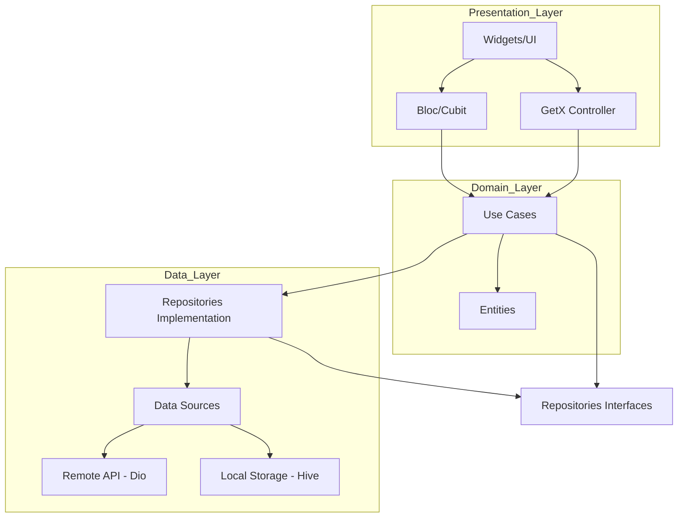

# SoundWave 🎵

SoundWave is a modern, feature-rich music player application built with Flutter. It focuses on providing a seamless and high-quality audio experience with a clean and intuitive user interface.

## 🚀 Features

- **High-Quality Playback:** Powered by `just_audio` and `audio_service` for robust background playback and notification controls.
- **Offline Support:** Local storage using `Hive` for your music library and preferences.
- **Dynamic UI:** Beautiful UI with blurring effects and dynamic themes.
- **Cross-Platform:** Designed to run on Android and iOS.
- **State Management:** Hybrid architecture using both `Bloc` and `GetX` for optimal performance and developer experience.

## 🏗 Architecture

SoundWave follows **Clean Architecture** principles to ensure the codebase is scalable, maintainable, and testable.

### Flow Architecture



### Layer Breakdown:

- **Data Layer:** Handles data retrieval from various sources (Local Hive DB, Remote APIs). Includes Models and Repository implementations.
- **Domain Layer:** Contains the core business logic (Use Cases) and business objects (Entities). It's independent of any other layer.
- **Presentation Layer:** Manages the UI and state. Uses Bloc for business logic and GetX for reactive UI state management.

## 🛠 Tech Stack

- **Framework:** [Flutter](https://flutter.dev/)
- **State Management:** [flutter_bloc](https://pub.dev/packages/flutter_bloc), [GetX](https://pub.dev/packages/get)
- **Dependency Injection:** [get_it](https://pub.dev/packages/get_it), [injectable](https://pub.dev/packages/injectable)
- **Audio Playback:** [just_audio](https://pub.dev/packages/just_audio), [audio_service](https://pub.dev/packages/audio_service)
- **Local Database:** [Hive](https://pub.dev/packages/hive)
- **Networking:** [Dio](https://pub.dev/packages/dio)
- **Functional Programming:** [dartz](https://pub.dev/packages/dartz)

## 📦 Getting Started

### Prerequisites

- Flutter SDK (refer to `pubspec.yaml` for version)
- Android Studio / Xcode

### Installation

1. Clone the repository:
   ```bash
   git clone https://github.com/your-repo/soundwave.git
   ```
2. Install dependencies:
   ```bash
   flutter pub get
   ```
3. Run code generation (for Injectable and Hive):
   ```bash
   flutter pub run build_runner build --delete-conflicting-outputs
   ```
4. Run the app:
   ```bash
   flutter run
   ```

## 🤖 CI/CD

This project uses GitHub Actions for automated builds.
- **Android:** Generates a release APK.
- **iOS:** Generates an unsigned IPA.

---
Made with ❤️ by Jules
