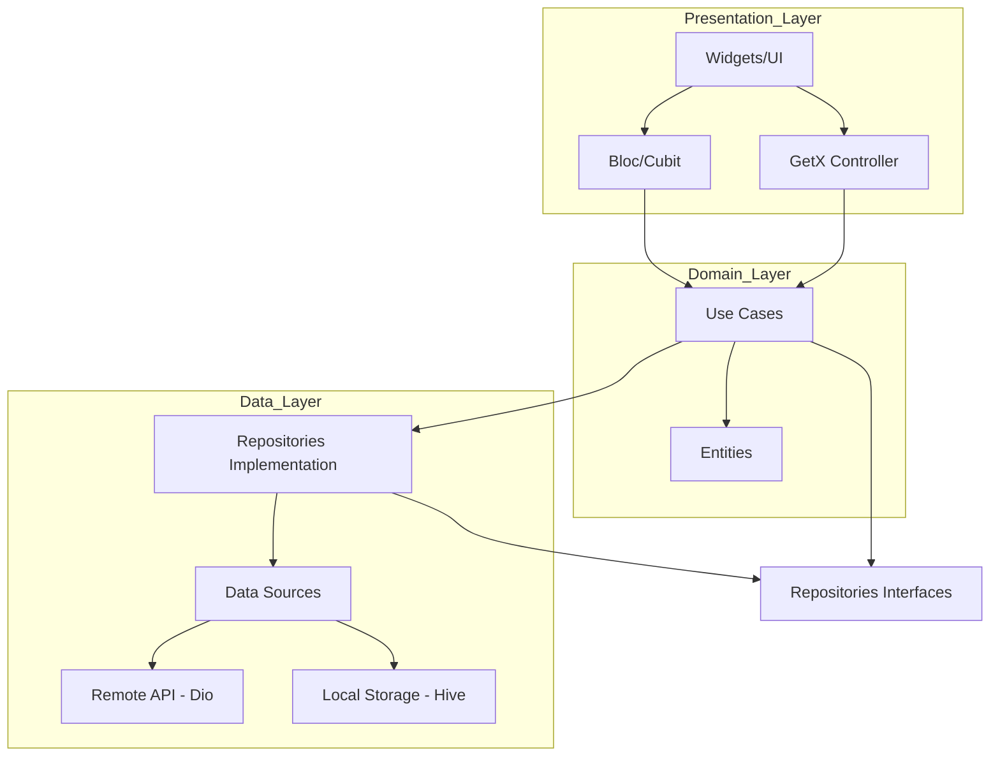

# SoundWave 🎵

SoundWave is a modern, feature-rich music player application built with Flutter. It focuses on providing a seamless, high-quality audio experience with a clean, dynamic, and intuitive user interface. 

## 🚀 Key Features

### 🎧 Core Playback & Audio
- **High-Quality Playback:** Powered by `just_audio` and `audio_service` for robust background playback, lock screen controls, and system notification integration.
- **Audio Optimization:** Uses `ffmpeg-kit` to automatically re-mux and fix metadata/duration issues for downloaded audio files.
- **Synced Lyrics:** Real-time synchronized lyrics support powered by a robust external API (`lrclib`).

### 🌐 YouTube Integration & Downloading
- **Built-in YouTube Search & Stream:** Search for your favorite songs directly from YouTube and stream them instantly without leaving the app.
- **Native Python Downloader (yt-dlp):** Uses a background Python server (`SeriousPython`) running the industry-standard `yt-dlp` to bypass 403 blocks and ensure stable, high-quality audio extraction.
- **Smart Download Management:** Instantly transition from a streamed song to a locally saved track with a single tap. Preserves original metadata (artist, title, high-res album art).
- **Background Worker Recovery:** Dynamic port allocation and recovery mechanism to ensure the background Python worker survives hot restarts and deep sleeps.

### 💾 Local Library & Storage
- **Offline Support:** Full offline library management powered by `Hive`, a fast NoSQL local database.
- **Smart Importer:** Scans device directories to automatically import local `.mp3`, `.m4a`, `.wav`, and `.flac` files into the app.
- **Data De-duplication:** Prevents duplicate files and preserves rich metadata even if the system rescans the directories.

### 🎨 Design & UI/UX
- **Dynamic Glassmorphism:** Beautiful frosted glass UI elements with fluid blurring effects.
- **Hero Animations:** Seamless and buttery smooth page transitions between the Home library and the Music Player view.
- **Dark Mode Optimization:** Deep blacks and high-contrast text perfect for OLED displays and nighttime listening.
- **Real-Time Progress:** Visually tracked download indicators and responsive playback sliders.

## 🏗 Architecture

SoundWave follows **Clean Architecture** principles to ensure the codebase is scalable, maintainable, and testable.

### Flow Architecture



### Layer Breakdown:

- **Data Layer:** Handles data retrieval from various sources (Local Hive DB, Python Worker, Remote APIs). Includes Models and Repository implementations.
- **Domain Layer:** Contains the core business logic (Use Cases) and business objects (Entities). It's independent of any other layer.
- **Presentation Layer:** Manages the UI and state. Uses `Bloc/Cubit` for complex player logic and `GetX` for reactive, lightweight UI states like download progress.

## 🛠 Tech Stack

- **Framework:** [Flutter](https://flutter.dev/)
- **State Management:** [flutter_bloc](https://pub.dev/packages/flutter_bloc), [GetX](https://pub.dev/packages/get)
- **Dependency Injection:** [get_it](https://pub.dev/packages/get_it)
- **Audio Playback:** [just_audio](https://pub.dev/packages/just_audio), [audio_service](https://pub.dev/packages/audio_service)
- **Local Database:** [Hive](https://pub.dev/packages/hive)
- **Background Services:** [serious_python](https://pub.dev/packages/serious_python)
- **Networking:** [Dio](https://pub.dev/packages/dio), [youtube_explode_dart](https://pub.dev/packages/youtube_explode_dart)

## 📦 Getting Started

### Prerequisites

- Flutter SDK (latest stable recommended)
- Python 3.10+ (for `yt-dlp` bundling during dev)
- Android Studio / Xcode

### Installation

1. Clone the repository:
   ```bash
   git clone https://github.com/your-repo/soundwave.git
   ```
2. Install dependencies:
   ```bash
   flutter pub get
   ```
3. Prepare the Python Backend Environment:
   *Ensure you have bundled the Python app properly inside the `app/app.zip` directory required by SeriousPython.*
   ```bash
   cd python_app
   zip -r ../app/app.zip . -x "*.pyc" "__pycache__/*" ".DS_Store"
   ```
4. Run the app:
   ```bash
   flutter run
   ```
*(Note: If you make changes to the Python files, you must recreate the `app.zip` and perform a **Full Restart** of the Flutter app, not just a Hot Reload).*

## 🤖 CI/CD

This project uses GitHub Actions for automated builds.
- **Android:** Generates a release APK.
- **iOS:** Generates an unsigned IPA.

---
Made with ❤️ by Jules
